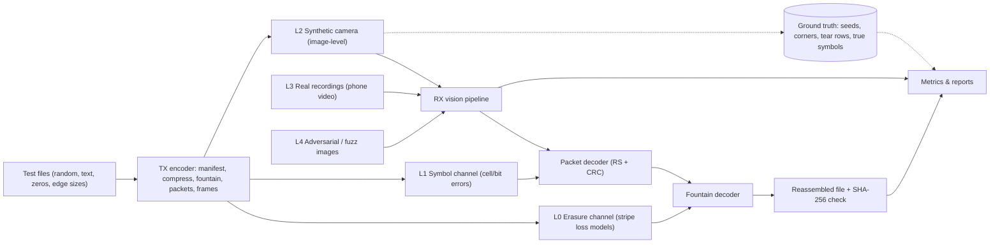
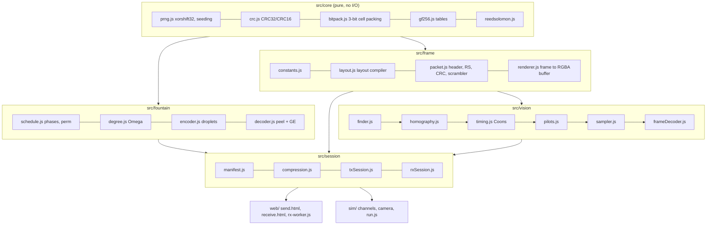
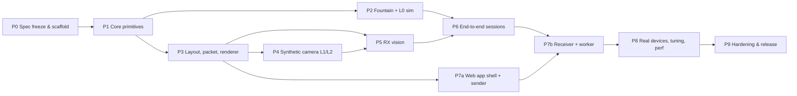

# ChromaStripe-JS — Implementation Plan v1

> Source design: [ChromaStripe-JS.md](./ChromaStripe-JS.md)
> Scope: a 100% vanilla-JS (no WASM, no OpenCV, **zero runtime dependencies**) screen→camera optical file transfer system, with:
> 1. a frozen, implementable v1 wire/layout spec,
> 2. a multi-level **simulation data construction** framework,
> 3. phased implementation with exit gates,
> 4. a **correctness and performance verification** program,
> 5. a simple **web app** that can send a file (screen) and receive it (camera).

---

## 0. Goals, Non-Goals, Success Criteria

### Goals
| # | Goal |
|---|---|
| G1 | Send any file from a laptop or desktop browser tab (sender) to a phone browser tab (receiver) over the optical channel only, with no network back-channel. |
| G2 | Pure ES-module JavaScript that runs unchanged in **Node ≥ 20** (tests, simulation, benchmarks) and in **modern browsers** (Chrome/Edge ≥ 116, Safari iOS ≥ 16.4, Firefox ≥ 113). |
| G3 | **No silent corruption.** The received file is either bit-exact (SHA-256 verified) or the transfer is reported as incomplete. |
| G4 | Real-time receive: the core decode (everything after the pixels are acquired) takes ≤ 4 ms p95 per frame on a mid-range phone, inside a Web Worker. |
| G5 | Useful throughput: **≥ 15 KB/s** sustained net payload for MVP, **≥ 25 KB/s** target, **≥ 40 KB/s** stretch (incompressible data, 720p30 camera, indoors). |

### Non-Goals (v1)
- A back-channel or ACKs from receiver to sender (the fountain code makes this unnecessary).
- Encryption or authentication (could be added later as an AEAD layer over the source stream).
- Multiple files per session. Users can zip them first.
- Native apps, WASM, or GPU/WebGL decode paths. These are possible later optimizations, not v1.

### Definition of Done (v1 release)
1. A 1 MB incompressible file transfers from a laptop (60 Hz panel) to a mid-range phone (720p30) at 30–50 cm indoors in ≤ 60 s in ≥ 90% of trials.
2. **0 silent corruptions** across ≥ 10,000 simulated transfers and ≥ 50 real transfers.
3. RX core decode ≤ 4 ms p95, and acquisition + decode ≤ 16 ms p95 on the reference mid-range phone.
4. The receiver UI preview stays smooth (no main-thread long tasks > 50 ms during a transfer).

---

## 1. Design Review — Issues Found and Resolutions

Before writing code, the source design needs fixes so it can be implemented and its claims hold. Each item below becomes a decision in the frozen spec (§2).

| # | Issue in source design | Impact | Resolution in v1 spec |
|---|---|---|---|
| R1 | **Stripe capacity is not uniform.** With 7×7 finders, 1-cell timing borders and 16 pilot blocks, equal 20-row stripes give `[1394, 1544, 1544, 1394]` data cells. The corner stripes cannot hold the claimed 1,456 cells / 546 B (verified by script). | The corner stripes cannot hold the packet. | Use 8×8 finder zones (7×7 + 1-cell separator) and **unequal stripe heights `[21, 19, 19, 21]` rows**, which gives `[1446, 1466, 1466, 1446]` cells. That is **≥ 542 B in every stripe**. Fixed packet = 542 B. |
| R2 | Header is listed as "10 bytes", but its fields add up to 11 B. A `Uint16` seed also caps the fountain seed space at 65,536. | The format doesn't add up, and long sessions run out of seeds. | 12-byte header with a **uint24 seed** (§2.4). |
| R3 | A single GF(256) Reed-Solomon codeword is limited to **255 bytes**, so "88 parity bytes correcting 44 errors" over a 546 B stripe is impossible as one codeword. | The inner ECC cannot be built as described. | **3 interleaved RS codewords** (byte `i` → codeword `i mod 3`), 82 parity bytes in total, t = 13–14 byte errors per codeword. Interleaving also spreads spatial bursts. |
| R4 | **Orientation is ambiguous.** Four identical bullseyes cannot tell a 0° frame from 90°, 180° or 270°. | Wrong decodes on rotated phones. | The bottom-right finder is **polarity-inverted** (magenta center, cyan ring). Corner order comes from that finder plus a convexity check. |
| R5 | **Data cells use the finder colors.** Data magenta `(255,40,255)` and cyan `(40,255,255)` produce the same R−G spikes as the finders. | False finder detections inside the code. | Detect by **run length**, not color alone. Finder rings and cores are drawn solid (no guard gaps), so they create continuous runs of ≥ 1 / 3 / 1 cells. Data cells are always broken by 2-px guards. The detector requires a 1:3:1 ratio and a vertical cross-check. |
| R6 | **Rolling-shutter axis.** Phone sensors are landscape-native. When the phone is held in portrait, the tear lines are **vertical** in screen space, so horizontal stripes all tear together. | Stripe yield collapses for portrait-held receivers. | The sender can **rotate the whole code by 90°** (manual toggle, or alternating every N frames). The receiver needs no signaling because the orientation finder (R4) recovers the logical axes. The simulator evaluates horizontal, rotated and alternating modes. The receiver UI shows a "hold landscape" hint. |
| R7 | **Unrealistic TX frame rate.** 40–55 KB/s assumes every 30 fps camera frame captures a fresh, clean frame. A 30 fps camera cannot reliably sample 30 fps content (aliasing, exposure blending). | The throughput claim is unrealistic. | TX frame rate is a parameter (`txHold` = number of vsyncs per frame: 60 Hz / {2,3,4,6} = 30/20/15/10 fps). The optimum is chosen by simulation and real measurement (§7.4). |
| R8 | **Fountain degree tables disagree** (prose 50/30/15/5 vs code 10/45/25/13/7). A post-systematic receiver is also missing about 15% of blocks, so low-degree droplets are mostly useless: P(a degree-2 droplet touches no unknown block) = 0.85² ≈ 72%. | The claimed ~1.03–1.08× overhead is unlikely. | Phase-3 degree distribution is **tuned for the post-systematic residual** (higher mean degree, ≈ 8–20), decoded with peeling + **inactivation / Gaussian elimination**. The distribution is picked by Level-0 simulation (§3.2). |
| R9 | **Bugs in the sample `getDropletIndices`:** `seed * 0x9E3779B9` is a float multiply (no uint32 wrap); `degree` is not clamped to `K` (infinite loop when K < 6); `xorshift32(0)` stays at 0 forever; `% K` adds modulo bias; it allocates a `Set` per call. | Non-portable or hanging code. | Use `Math.imul`, `degree = min(degree, K)`, a non-zero state guard, rejection sampling, and a preallocated index buffer. |
| R10 | "Adjacent-block" Phase-2 parity does not protect against **burst** losses (shake, or a tear stuck on one stripe position for seconds). | Phase 2 adds little. | Use **strided parity** (`b[j] ⊕ b[j+S] ⊕ b[j+2S]`, S ≈ K/3). This is configurable and validated with burst-loss models. |
| R11 | Payload-keyed whitening means the receiver must parse the header before it can de-whiten, but the header is itself unwhitened and unprotected. | Chicken-and-egg problem; the header is weak. | **A single scrambler over the entire 542 B coded packet**, seeded only by `(layoutVersion, stripeIndex)`. The receiver de-whitens before RS decoding. |
| R12 | Pilot interpolation: the prose says bilinear, but the code uses nearest-quadrant. There is also no color-crosstalk handling. | Thresholds are wrong under gradients or glare. | Bilinear interpolation over the 4×4 pilot lattice with clamped extrapolation. Optional v1.1: a per-region **affine color correction**. The 4 pilot colors W/K/C/M are affinely independent, so a 3×4 affine matrix is exactly solvable. |
| R13 | 1-D `du[80]` / `dv[80]` arrays cannot represent 2-D barrel distortion in the interior. | Sampling drifts near the center of the edges and in the interior. | **Coons-patch interpolation** of the 4 border-residual curves into a per-cell offset field. |
| R14 | No file metadata (name, exact length, hash) and no session identity. | The receiver cannot trim padding, name the file, or verify it. | A **manifest** stored at the head of the source stream, a `sessionId` in every header, and an end-to-end SHA-256 check. |
| R15 | The sampler has no bounds checks, so a homography that goes partly off-frame reads out of bounds. | `NaN` values or wrong reads. | The frame is rejected when any projected corner or cell is outside the frame minus a margin. |
| R16 | "100–180 KB/s with compression" only applies to compressible inputs. | Misleading expectations. | Report net (incompressible) throughput as the headline metric. If deflate does not shrink the data, the manifest records `compression = none`. |

---

## 2. Frozen v1 Specification

All constants live in a single module, `src/frame/constants.js`. The layout is generated by a **layout compiler** (`src/frame/layout.js`) that both TX and RX use, so they can never disagree.

### 2.1 Grid & Rendering
| Parameter | Value |
|---|---|
| Logical grid | 80 × 80 cells |
| Cell geometry (at scale s) | 10s × 10s px: **8s × 8s solid core** + **s-px black guard on each side** (2s px of black between neighboring cores) |
| Base canvas | 800 × 800 device px at s = 1. The renderer chooses the largest integer s that fits the viewport (in **device** pixels, using `devicePixelRatio`) |
| Quiet zone | ≥ 2 cells of mid-gray (`#808080`) around the code |
| Image smoothing | Off. The canvas is backed 1:1 by device pixels, with CSS `image-rendering: pixelated` |
| Data colors | 3 bits per cell `(b2,b1,b0)` → `R = b2 ? 255 : 40`, `G = b1 ? 255 : 40`, `B = b0 ? 255 : 40` |

### 2.2 Cell Map (layout compiler output)
| Cell class | Location | Count |
|---|---|---|
| Finder zone `F` | 8×8 at each corner: a 7×7 bullseye (black outer ring 7×7, magenta ring 5×5, cyan core 3×3; **bottom-right inverted**: cyan ring, magenta core) plus a 1-cell black separator on the inner sides | 4 × 64 |
| Timing `T` | Row 0, row 79, col 0, col 79, outside finder zones. Cells alternate white/black, starting white at the finder edge | 4 × 64 |
| Pilot `P` | 2×2 blocks at rows/cols `{9,10}+20i`, i = 0..3 → 16 blocks: `[W(111) K(000); C(011) M(101)]` | 64 |
| Data `D` | Everything else | 5,824 |
| Stripes | Row ranges `[0–20], [21–39], [40–58], [59–79]` (heights 21/19/19/21) | `[1446,1466,1466,1446]` data cells |

- Data cells are ordered in **raster order within the stripe** (row-major, left→right, top→bottom).
- Each cell carries 3 bits, MSB first: the bit stream maps `bit2→R`, `bit1→G`, `bit0→B`.
- Each stripe consumes 542 B = 4,336 bits = **1,445⅓ cells → 1,446 cells**. Leftover cells in the middle stripes (20 each) carry scrambler fill.
- The compiler asserts at build time and in tests that no cell classes overlap, that the counts match, and that `min(capacity) ≥ 1446`.

### 2.3 Rotation Mode (R6)
`txRotation ∈ {0°, 90°}`. The whole code is rotated. The receiver recovers the logical orientation from the inverted finder. `rotationSchedule ∈ {fixed0, fixed90, alternate(N)}`. The default is chosen after the Phase-4 simulation gate.

### 2.4 Stripe Packet (542 B, before scrambling)
| Offset | Size | Field |
|---|---|---|
| 0 | 1 | `ver(2b)=01` · `stripeIdx(2b)` · `phase(2b)` (0 = systematic, 1 = parity, 2 = fountain) · `reserved(2b)` |
| 1 | 3 | `seed` (uint24, big-endian) |
| 4 | 2 | `K` (uint16), number of source blocks |
| 6 | 2 | `sessionId` (uint16) = first 2 bytes of SHA-256(manifest) |
| 8 | 4 | `CRC32` (IEEE 802.3, reflected, poly `0xEDB88320`) over bytes 0–7 plus the 448 B payload |
| 12 | 448 | Payload: one droplet (`Uint32Array(112)`) |
| 460 | 82 | RS parity: 3 interleaved codewords. Data split 154/153/153 + parity 28/27/27 → codewords of 182/180/180 B |

- **RS:** GF(2⁸), primitive polynomial `0x11D`, generator roots α⁰…α^(n−k−1). Decoding uses Berlekamp–Massey, Chien search and Forney. v1.1 adds errors-and-erasures decoding driven by cell confidence.
- **Scrambler (R11):** XOR all 542 bytes with a `xorshift32` stream seeded by `0xC5A0_0000 | (ver << 8) | stripeIdx`. The same stream fills the unused cells.
- **Max file:** K ≤ 65,535 → ≤ 29.3 MB of source stream. The UI warns above 10 MB because of transfer time.

### 2.5 Source Stream & Manifest
```
sourceStream = manifest || payloadBytes || zeroPad  (to K * 448 bytes)
manifest = magic "CSv1"(4) | manifestLen u16 | flags u8 (compression: 0 none, 1 deflate-raw)
         | originalSize u32 | payloadSize u32 | sha256(original) [32]
         | nameLen u8 | name utf8 | mimeLen u8 | mime utf8
```
- The sender compresses with `CompressionStream('deflate-raw')`. If the result is not at least 2% smaller, it sends the raw bytes and sets `flags = 0`.
- The receiver reassembles, parses the manifest from block 0, decompresses with `DecompressionStream`, and checks the SHA-256 with `crypto.subtle.digest`.

### 2.6 Fountain Code & Transmission Schedule
| Phase | Seeds | Content |
|---|---|---|
| 1 Systematic | `0 … K−1` | `block[seed]` (degree 1) |
| 2 Strided parity | `K … K + ⌈αK⌉ − 1` (α = 0.15, tunable) | `j = seed − K`: XOR of blocks `{j, j+S, j+2S} mod K`, S = ⌈K/3⌉ (tunable) |
| 3 Rateless | `≥ K + ⌈αK⌉` (up to 2²⁴ − 1, then wraps to Phase 3 start) | `xorshift32`-seeded degree from distribution `Ω` (chosen by §3.2), with distinct uniform indices |

- Seeds are assigned to `stripeIdx` 0..3 of frame `f` as `4f + i`. Phase-1 order is **block-interleaved** (`seed = (4f+i)` maps to `block = perm(4f+i)`, where `perm` is a fixed bit-reversal-like permutation), so a tear stuck on one stripe position does not remove a contiguous run of the file.
- **Decoder:** maintain `solved[K]` plus a waiting list. On ingest, XOR out the known blocks. If one unknown is left, mark it solved and peel recursively. When `rank(waiting) + solved == K`, run **inactivation Gaussian elimination** on a bit-packed coefficient matrix over the unknown blocks only (rows = `Uint32Array(⌈m/32⌉)`, RHS = `Uint32Array(112)`). Option: on-the-fly GE to spread the cost.
- Duplicate seeds are dropped with a `Uint8Array` bitmap over the seed space (sized as needed).

### 2.7 RX Vision Pipeline (per camera frame)
1. **Acquire:** RGBA `Uint32Array` (camera width × height).
2. **Finder search:** compute `c = R − G` on every 4th row. Classify into `{+, −, 0}` with hysteresis thresholds (adaptive, starting at ±48). Run-length encode and match `0 | + a | − b | + c | 0` (or the inverted pattern for the BR finder) with `b ≈ 3a ≈ 3c` (±50%) and `a ≥ 2 px`. Then cross-check vertically, cluster candidates, and refine to a sub-pixel center (centroid of core pixels). **Tracking mode:** once locked, search only ROIs around the previous corners and do a full rescan every 15 frames or when lock is lost.
3. **Order corners:** use the inverted finder to identify BR, then the convex-hull order gives TL/TR/BL.
4. **Homography:** 4-point DLT, mapping logical finder centers `(3.5,3.5), (76.5,3.5), (3.5,76.5), (76.5,76.5)` to camera coordinates (8×8 solve with partial pivoting).
5. **Timing refinement:** for each timing cell, search ±2 px around the projected center for the luminance extremum centroid. Median-filter the residuals into 4 edge curves, then build a **Coons patch** offset field for interior cells.
6. **Pilot thresholds:** sample each pilot cell (3×3 px mean). For each channel, `T = (mean(hi) + mean(lo)) / 2`. Reject the region if `hi − lo < 40`. Interpolate bilinearly per cell.
7. **Sample:** for each data cell, take the mean of a 2×2 px block at the corrected center. Slice into 3 bits with a branchless comparison. Record a confidence `min_ch |v − T| / (hi − lo)` for later erasure decoding.
8. **Per stripe:** pack bits → de-scramble → RS-decode 3 codewords → CRC32 → parse header → ingest into the fountain decoder if `sessionId` matches.
9. **Allocation-free hot path:** all buffers are preallocated once per resolution.

---

## 3. Simulation Data Construction

Simulation is the backbone of development. Every RX stage is built and tuned against **synthetic data with exact ground truth** before it touches a real camera. There are five levels, from fastest to most realistic. All of them are deterministic, driven by a seeded PRNG and a scenario JSON file.



### 3.1 Test Corpus (inputs)
`sim/corpus.js` generates files deterministically (they are never committed):
| ID | Content | Purpose |
|---|---|---|
| C0 | 0 B, 1 B, 447 B, 448 B, 449 B, `448·K ± 1` | Padding and boundary handling |
| C1 | 64 KB, 1 MB, 10 MB of PRNG bytes | Incompressible; throughput headline |
| C2 | 1 MB of repetitive English text and JSON | Compression path |
| C3 | All `0x00` and all `0xFF` | Whitening / exposure stability |
| C4 | Real binaries (PNG, ZIP, PDF), checked in under `test/fixtures/` (≤ 200 KB each) | Realistic mixes |
| C5 | Unicode file names (emoji, RTL, 255-byte names) | Manifest encoding |

### 3.2 Level 0 — Stripe-Erasure Channel (fountain and schedule tuning)
Simulates only *which stripes arrive*, at millions of trials per minute.

Loss models (`sim/channels/erasure.js`):
- **Bernoulli(p):** independent stripe loss, p ∈ {0, 0.05, 0.15, 0.3, 0.5}.
- **Gilbert–Elliott:** good/bad states with burst lengths of 5–60 frames (shake, refocus).
- **Stuck tear:** one stripe position is lost with probability q_s, and that position drifts slowly (beat frequency between display and camera).
- **TX/RX rate model:** TX at `f_tx` fps, camera at `f_cam` with jitter. Each TX frame is captured 0..n times, and each capture tears at a random row → per-stripe survival.
- **Frame drops:** the receiver worker is busy, or the browser drops frames.

Experiments:
- E0.1: overhead `ε = received_distinct / K − 1` vs K ∈ {1, 2, 3, 10, 100, 1000, 4096, 20000} for candidate Ω:
  (A) prose table, (B) code table, (C) Robust Soliton (c = 0.03, δ = 0.5), (D) **residual-shifted** distribution (mean degree ≈ 1/p̂), (E) a fixed degree of 12–20.
- E0.2: Phase-2 variants: none, adjacent, strided (S = K/3, K/2), α ∈ {0.05, 0.1, 0.15, 0.25}.
- E0.3: GE cost (ms) vs unknown count m. Peeling-only vs inactivation.
- E0.4: Phase-1 permutation vs identity under the stuck-tear model.

Output: `reports/L0/*.json` plus CSV, and plots generated by a tiny SVG writer (no dependencies). **Gate:** pick Ω, α and S so that mean ε ≤ 0.08 and p99 ε ≤ 0.20 at K = 1000, p = 0.15 (Bernoulli and stuck-tear).

### 3.3 Level 1 — Symbol / Bit Channel (inner code tuning)
Operates on packed stripe bits (542 B) or on cell symbols, before rendering.
- Independent per-channel bit flips (p_R, p_G, p_B differ; the B channel is usually noisiest).
- Spatially correlated error blobs over the 2-D stripe cell map (glare spot): Gaussian-shaped flip probability.
- **Row bursts:** all cells below row r in a stripe are randomized (a tear inside the stripe).
- Cell erasures: low-confidence flags with a configurable accuracy, used to test erasure decoding.

Experiments: post-RS stripe success vs raw symbol error rate (SER) for interleave depth ∈ {1 (invalid >255), 3, 4, 6} and parity split. RS miscorrection rate and **CRC32 false-accept count** (must be 0 observed; the theoretical rate is ≈ 2⁻³² per miscorrection).
**Gate:** ≥ 99% stripe success at raw byte error rate 3%; 0 false accepts in 10⁸ corrupted packets.

### 3.4 Level 2 — Synthetic Camera (image-level, the core simulation)
`sim/camera/` renders realistic camera frames from the exact TX frame buffers, with full ground truth. Everything is computed in **linear light** (float32) and gamma-encoded at the end.

**Pipeline per simulated camera frame** (time `t_c`, camera W × H):
1. **Timing model.** TX frame `k` is shown from `k · T_hold` (T_hold = txHold / refreshHz). The display scans out top→bottom: screen row `y_s` updates at `k · T_hold + (y_s / H_s) · T_scan`. Camera row `y` exposes during `[t_c + (y/H)·T_readout, + T_exp]`. Each pixel's value is the **time-weighted blend** of the TX frames visible to it during its exposure window. This produces tears *and* blended bands naturally.
2. **Geometry.** Pose = scale (code height as a fraction of the frame, 0.5–0.95), yaw/pitch ±25°, roll ±180° (exercises orientation), translation, plus **per-frame shake** (random walk of 0–3 px/frame) and **lens distortion** (`k1 ∈ [−0.15, 0.05]`, `k2`). Inverse mapping: camera px → undistort → H⁻¹ → screen px. **2×2 supersampling** per camera pixel approximates pixel integration and produces moiré/aliasing.
3. **Display model.** Panel gamma 2.2. Optional sub-pixel RGB stripe structure (screen pixels split into R/G/B thirds) to reproduce color fringes at low px/cell. Optional backlight PWM flicker (frequency, depth).
4. **Optics.** Separable Gaussian PSF σ ∈ [0.4, 2.0] camera px, plus defocus σ.
5. **Lighting.** Additive specular glare blob (position, radius, intensity up to 0.6 of white), linear brightness gradient, vignetting (cos⁴ approximation), ambient veil (0–10%).
6. **Color.** 3×3 crosstalk matrix (diagonal 0.75–0.95), AWB gains (0.8–1.25 per channel), saturation scale, exposure gain, black level.
7. **Sensor.** Shot noise (Poisson, approximated as Gaussian ∝ √signal), read noise σ ∈ [0.5, 4] DN, clip, gamma-encode to 8 bit.
8. **Codec.** BT.601 YCbCr **4:2:0** (box-downsample chroma, bilinear upsample). Optional 8×8 DCT quantization (JPEG-like, quality 60–95) to emulate video compression in recorded clips.
9. **Background.** Procedural scene outside the screen: noise textures, gradients, keyboard-like black/white grids, and **distractor magenta/cyan objects** to test finder false positives.
10. **Frame drops.** The camera skips frames with probability p_drop. Timestamp jitter ±2 ms.

**Ground truth emitted per frame (`truth.jsonl`):**
`{frameIdx, tC, corners:[[x,y]×4 camera px, logical TL/TR/BL/BR], H, rotation, txFramesPerRow:[{y0,y1,k,weight}], tearRows:[...], stripeTruth:[{stripeIdx, k, seed, cleanFraction}], params:{...}}`
Together with the deterministic TX, this gives the exact expected symbols for every cell. Per-stage metrics are computed against it:
- finder localization error (px), homography reprojection RMSE, timing-refined cell-center error,
- per-stripe raw SER (before RS), RS correction count, CRC pass/fail, false accepts,
- stripe yield vs `cleanFraction` (separates vision failures from physics: a torn stripe is *expected* to fail).

**Scenario presets** (`sim/scenarios/*.json`), each with parameter *ranges* so that each trial draws random parameters from them:
| Preset | Highlights |
|---|---|
| `ideal` | Frontal, px/cell = 10, no noise, no blur, global shutter, txHold = 4 |
| `indoor-typical` | 720p, px/cell 6–8, yaw/pitch ±15°, σ_psf 0.8, read noise 2, 4:2:0, readout 20 ms, exposure 16 ms |
| `indoor-handheld` | `indoor-typical` + shake 1.5 px/frame, k1 = −0.08, drops 3% |
| `outdoor-glare` | Glare 0.3–0.6, gradient 0.25, exposure 4 ms, AWB drift |
| `low-res` | 480p, px/cell 4.5–6 (finds the minimum resolvable cell size) |
| `portrait-hold` | Readout axis rotated 90° (vertical tears); used to evaluate R6 rotation modes |
| `recorded-video` | `indoor-typical` + DCT quality 70 |
| `adversarial` | Extreme ranges, distractors, partial occlusion (finger blob over 5–15% of the code), code partly out of frame |
| `sweep-*` | One parameter swept across a grid with all others ideal (waterfall curves) |

**Scenario file format (example):**
```json
{
  "name": "indoor-handheld",
  "seed": 1337,
  "camera":   { "width": 1280, "height": 720, "fps": 30, "readoutMs": 20, "exposureMs": [8, 16], "jitterMs": 2, "dropProb": 0.03 },
  "display":  { "refreshHz": 60, "txHold": 4, "scanMs": 16.7, "cellPx": 10, "gamma": 2.2, "subpixel": true, "pwmHz": 0 },
  "geometry": { "codeHeightFrac": [0.7, 0.9], "yawDeg": [-15, 15], "pitchDeg": [-15, 15], "rollDeg": [-8, 8], "k1": [-0.1, -0.03], "shakePx": 1.5 },
  "optics":   { "psfSigma": [0.6, 1.2] },
  "lighting": { "glare": { "p": 0.3, "intensity": [0.1, 0.4], "radiusFrac": [0.1, 0.3] }, "gradient": [0, 0.15], "vignette": 0.25, "ambient": [0, 0.05] },
  "color":    { "crosstalkDiag": [0.8, 0.95], "awbGain": [0.85, 1.15], "saturation": [0.75, 1.0], "blackLevel": 8 },
  "sensor":   { "readNoise": [1, 3], "shot": 0.015, "chroma420": true, "dctQuality": null },
  "background": { "type": "procedural", "distractors": 2 },
  "durationSec": 20
}
```

**Run modes:**
- **Streaming (default):** `node sim/run.js --scenario indoor-handheld --file C1:1MB --trials 50` runs TX → camera model → RX entirely in memory and reports completion time, ε, yield and per-stage metrics.
- **Dataset export:** `node sim/gen-dataset.js --scenario X --frames 300 --out data/sim/X/` writes `frame_00001.rgba` (raw), an optional `.png` (minimal PNG encoder on top of built-in `node:zlib`) and `truth.jsonl`. Used for golden regression sets and visual debugging.
- **In-browser:** `web/sim.html` runs the same camera model live with sliders, as a loopback demo and debugging tool.

**Performance of the simulator:** about 1–2 M camera pixels/s per core in Node with 2×2 supersampling → ~0.5–1 s per 720p frame. Trials are parallelized with `node:worker_threads` (built in). A 20 s session (600 frames) at 8 cores takes ≈ 1 minute. The CI smoke subset uses 360p and short sessions.

### 3.5 Level 3 — Real-Capture Datasets
- **Capture protocol:** the sender runs in a "logging" mode that writes `{wallTime, frameNo, seeds[4], rotation}` per rendered frame. The phone records 1080p30 / 720p30 video (native camera app *and* the in-browser `MediaRecorder` path). Each clip is 30–60 s. The metadata records device, distance, angle, lighting (lux meter app), screen model and brightness.
- **Ground truth without timestamps:** packets are a **deterministic function of (file, seed)**. Whenever the receiver decodes a header seed, the test harness regenerates the exact TX packet and compares bit by bit. This yields exact pre-RS BER on real footage and catches false accepts.
- **Replay:** `node tools/replay.js clip.mp4` extracts frames with `ffmpeg` (a dev-only tool, not a runtime dependency) to raw RGBA and feeds the RX pipeline. In the browser, `receive.html?source=file` plays the clip in a `<video>` element and uses `requestVideoFrameCallback`.
- **Matrix:** ≥ 3 phones (low-end Android, mid-range Android, iPhone) × 3 distances (25/40/60 cm) × 3 angles (0°/15°/30°) × 3 lighting conditions (dim, office, window glare) × {landscape, portrait} × txHold ∈ {2,3,4}.
- Storage: `data/real/` (git-ignored). An index `data/real/index.json` is committed. A curated subset of 10–20 short clips (≈ 200 MB) goes to Git LFS or a release asset for regression.

### 3.6 Level 4 — Adversarial & Fuzz
- Random RGBA frames, natural photos (no code), photos containing magenta/cyan objects, screenshots of text/IDEs, keyboards, window blinds. **Expected:** no lock, or a lock that never yields a CRC-valid packet.
- Mutated real frames: bit-flipped buffers, truncated buffers, wrong dimensions, NaN homographies, 1×1 frames.
- Protocol fuzz: random but CRC-valid packets with absurd fields (K = 0, K changing mid-session, seed beyond the range, wrong version). **Expected:** rejected or session reset, never a crash.

---

## 4. Architecture & Repository Layout



```
ChromaStripe-JS/
├─ package.json                 # "type":"module", scripts only, NO dependencies
├─ src/
│  ├─ core/        prng.js crc.js bitpack.js gf256.js reedsolomon.js sha256.js(fallback) bench-util.js
│  ├─ fountain/    degree.js schedule.js encoder.js decoder.js gauss.js
│  ├─ frame/       constants.js layout.js packet.js scrambler.js renderer.js
│  ├─ vision/      finder.js homography.js timing.js pilots.js sampler.js frameDecoder.js
│  └─ session/     manifest.js compression.js txSession.js rxSession.js
├─ sim/
│  ├─ corpus.js  run.js  gen-dataset.js  report.js  svgplot.js
│  ├─ channels/  erasure.js  symbol.js
│  ├─ camera/    timing.js geometry.js display.js optics.js lighting.js color.js sensor.js codec.js background.js index.js
│  └─ scenarios/ *.json
├─ test/
│  ├─ harness.js                # maps to node:test in Node, tiny runner in browser
│  ├─ unit/        *.test.js
│  ├─ integration/ *.test.js
│  ├─ golden/      vectors.json (CRC/RS/PRNG/packet/frame hashes)
│  ├─ fixtures/    small real files
│  └─ browser.html              # runs the same tests in any browser
├─ bench/  kernels.bench.js  e2e.bench.js  bench.html  baseline.json
├─ web/
│  ├─ index.html  send.html  receive.html  sim.html
│  ├─ css/app.css
│  └─ js/ send-app.js receive-app.js rx-worker.js tx-render.js ui.js
├─ tools/  serve.js (node:https/http static server)  replay.js  make-cert.sh
├─ reports/ (git-ignored)   data/ (git-ignored)
└─ docs/   spec-v1.md  sim-guide.md  device-results.md
```

**Principles**
- `src/` is **environment-agnostic**: no DOM, no Node APIs. It only uses typed arrays and `globalThis.crypto` / `CompressionStream` (available in both Node ≥ 20 and browsers). The renderer writes into a `Uint8ClampedArray`. The browser does `putImageData`, while the simulator reads the same buffer.
- Hot paths are **allocation-free**: they take preallocated buffers through a `ctx` object created per resolution.
- Every module exports pure functions plus an explicit state object, so they are easy to test and benchmark.

---

## 5. Implementation Phases

Each phase has **tasks → deliverables → exit gate**. A phase is not complete until its gate passes in CI.



### P0 — Spec Freeze & Scaffolding (0.5 wk)
- Tasks: write `docs/spec-v1.md` from §2, including the resolutions R1–R16. Create `package.json` scripts (`test`, `test:browser`, `sim`, `bench`, `serve`), `test/harness.js`, a CI workflow (Node 20 and 22), `.editorconfig`, and a lint rule set (optional, dev-only).
- Deliverables: repository skeleton, spec document, green empty CI.
- **Gate:** spec reviewed; `layout.js` prototype reproduces the capacities `[1446,1466,1466,1446]`.

### P1 — Core Primitives (1 wk)
- `prng.js`: `xorshift32` with a zero-state guard; `seedMix(seed)` built on `Math.imul` (murmur3 fmix32); `nextBelow(n)` by rejection sampling.
- `crc.js`: table-driven CRC32 (slice-by-4 optional) and CRC16-CCITT.
- `bitpack.js`: bytes ↔ 3-bit symbols (bytes → `Uint8Array` of symbols and back) with exact bit accounting.
- `gf256.js` + `reedsolomon.js`: log/antilog tables, systematic encoder (LFSR), and a decoder (syndromes → Berlekamp–Massey → Chien → Forney) that returns `{ok, corrected}`. Erasure support is stubbed for v1.1.
- `sha256`: use `crypto.subtle`. A pure-JS fallback exists only for non-secure contexts used in tests.
- Deliverables: modules plus unit tests plus microbenchmarks.
- **Gate:** golden vectors pass (CRC32("123456789") = `0xCBF43926`; RS vectors cross-checked offline against Python `reedsolo`, committed as JSON); RS property tests (§6.2); kernel budgets met in Node (§7.1).

### P2 — Fountain Code + Level-0 Simulation (1.5 wk)
- `degree.js` (pluggable Ω tables), `schedule.js` (phases, Phase-1 permutation, strided parity), `encoder.js` (allocation-free droplet into a preallocated `Uint32Array(112)`), `decoder.js` (peeling with adjacency lists + `gauss.js` inactivation GE over a bit-packed matrix).
- `sim/channels/erasure.js` with all loss models; `sim/run.js --level 0`.
- Run experiments E0.1–E0.4 and commit `reports/L0-summary.md` with the chosen Ω, α and S.
- **Gate:** exact recovery in 100% of trials for K ∈ {1..20000} once enough droplets have arrived; ε targets from §3.2 met; GE for m = 1000 unknowns takes ≤ 150 ms in Node.

### P3 — Layout Compiler, Packet, Renderer, TX Session (1 wk)
- `layout.js`: generates `cellClass[6400]`, the per-stripe ordered data-cell index lists, pilot/timing/finder coordinate tables, and the rotation transform. Results are memoized.
- `packet.js`: `buildPacket(header, payload) → 542 B` (CRC, RS ×3 interleaved, scramble) and `parsePacket(542 B) → {ok, header, payload, corrected}`.
- `renderer.js`: renders a frame (4 packets + static structure) into an RGBA buffer at scale `s` with rotation. Static layers (finders, timing, pilots, guards) are cached and only data cores are repainted.
- `txSession.js`: file → compress → manifest → source blocks → endless frame iterator `{frameNo, seeds[4], rgba}`.
- **Gate:** round trip `parsePacket(buildPacket(x)) === x` for 10⁵ random headers and payloads; an "ideal oracle RX" that reads cell colors directly from the rendered buffer (no vision) decodes 100% of stripes; golden frame hash test (SHA-256 of the RGBA buffer for fixed inputs) is pinned.

### P4 — Channel Simulators L1 + L2 (1.5 wk, can overlap P5)
- `sim/channels/symbol.js` (L1). `sim/camera/*` (L2) as specified in §3.4, with per-module unit tests: e.g. the geometry model with an identity pose returns the input image; a 4:2:0 round trip on gray is lossless; noise σ is measured to within ±5%.
- Scenario presets, dataset export, the PNG writer, and the parallel trial runner.
- Run the L1 experiments and commit `reports/L1-summary.md` (confirm the RS split and interleave depth).
- Run the R6 study: horizontal vs rotated vs alternating modes under `portrait-hold`. **Choose the default `rotationSchedule`.**
- **Gate:** the simulator produces visually plausible frames (manual review of a contact sheet `reports/L2-contact.png`); ground-truth corners reproject to within 0.1 px in `ideal`; tear rows match the analytic expectation.

### P5 — RX Vision Pipeline (2 wk)
Build stage by stage, each validated in isolation with L2 ground truth:
1. `finder.js` → metric: detection rate ≥ 99.5% and localization error ≤ 0.5 px (`indoor-typical`); 0 false locks in L4 natural images.
2. `homography.js` → reprojection RMSE ≤ 0.3 px on the ground-truth corners.
3. `timing.js` (Coons patch) → cell-center error p99 ≤ 0.25 cell with k1 = −0.1 (vs ≥ 0.4 without refinement).
4. `pilots.js` → per-channel threshold error; SER under glare with vs without bilinear interpolation.
5. `sampler.js` → raw SER per scenario.
6. `frameDecoder.js` → glue code, tracking mode, per-stripe RS/CRC, stats object.
- **Gate (stripe yield = CRC-valid stripes / stripes with cleanFraction = 1):** `ideal` 100%, `indoor-typical` ≥ 98%, `indoor-handheld` ≥ 95%, `outdoor-glare` ≥ 85%. **0 false accepts** across all scenarios. Node decode time ≤ 1.5 ms per 720p frame (excluding acquisition).

### P6 — End-to-End Sessions in Node (1 wk)
- `rxSession.js`: session lock on `sessionId`/`K`, duplicate filter, fountain ingest, progress events, finalize (manifest → decompress → SHA-256).
- Full pipeline tests: corpus C0–C5 × scenarios (`ideal`, `indoor-typical`, `indoor-handheld`, `portrait-hold`) × txHold ∈ {2,3,4}.
- Produce the **throughput model calibration** report (§7.4).
- **Gate:** 100% bit-exact completions in non-adversarial scenarios (≥ 1,000 transfers); 0 silent corruptions in all scenarios including adversarial; median simulated 1 MB completion time ≤ 60 s for `indoor-typical`.

### P7 — Web App (1.5 wk; P7a sender can start after P3)
See §8. P7a: static shell, sender page, renderer integration, frame pacing. P7b: receiver page, camera acquisition, worker pipeline, overlays, completion flow, `sim.html` loopback.
- **Gate:** loopback (`sim.html`) completes a 1 MB transfer in Chrome and Safari; a real laptop→phone transfer of 100 KB works on at least one Android and one iPhone.

### P8 — Real-Device Validation, Tuning, Performance (2 wk)
- Record the L3 dataset (§3.5). Replay it through the Node RX and fix vision issues against real footage.
- Tune adaptive thresholds, sampling footprint (1 px vs 2×2 vs plus-pattern), finder tolerances, txHold default, RS split, and rotation schedule.
- Profile on devices (§7.2): acquisition path options (`getImageData` vs `VideoFrame.copyTo` RGBA vs direct NV12/I420 sampling of only the needed pixels), worker transfer cost, GC.
- Optional v1.1 items if budget allows: RS errors-and-erasures from cell confidence; affine color correction from pilots.
- **Gate:** Definition of Done items 1, 3 and 4 (§0) met on the reference devices.

### P9 — Hardening, Docs, Release (1 wk)
- Error UX (camera denied, insecure context, unsupported browser), large-file warnings, Wake Lock, accessibility (photosensitivity warning: the code flickers at 10–30 Hz; respect `prefers-reduced-motion` by defaulting to a lower fps).
- Docs: README quick start, `docs/sim-guide.md`, `docs/device-results.md`, spec v1 final.
- Tag `v1.0.0`; publish the static site (GitHub Pages, HTTPS).
- **Gate:** all CI suites green; full nightly simulation sweep green; DoD item 2 met.

**Estimated total:** ≈ 13 engineer-weeks for one engineer (≈ 9 weeks with two working in parallel on P4/P5 and P7a).

---

## 6. Correctness Verification

### 6.1 Test Infrastructure
- **Runner:** `node --test` (built in). `test/harness.js` re-exports `test`/`assert` in Node and supplies a 60-line runner for `test/browser.html`, so **the same test files run in browsers** (important for typed-array, `CompressionStream` and `crypto.subtle` behavior differences).
- **Property testing:** a small built-in generator (`test/prop.js`) driven by the seeded PRNG, with failing-seed reporting and replay (`PROP_SEED=…`).
- **Golden vectors:** `test/golden/vectors.json`, regenerated only by `npm run golden:update` with a mandatory review. Any change in packet or frame hashes is a **wire-format break** and must bump `ver`.

### 6.2 Unit Tests (per module)
| Module | Tests |
|---|---|
| prng | Known sequences; never returns 0; `nextBelow` χ² uniformity (p > 0.001) for n ∈ {3, 1000, 65535} |
| crc | Standard check values; incremental == one-shot |
| bitpack | Round trip at all lengths 0..1000 bytes; exact cell counts (542 B → 1446 cells) |
| gf256 / RS | Field axioms (exhaustive mul/inv); encode is systematic; **corrects any e ≤ t random errors** (10⁵ trials per t); e > t → `ok=false` or miscorrection (rate logged, must be caught by CRC in packet tests); burst errors across interleaved codewords |
| layout | No overlaps; class counts; stripe capacities; rotation is a bijection; TX and RX views identical |
| packet | Round trip; single-bit flips anywhere are corrected; header corruption beyond RS → CRC fail; scrambler is an involution |
| degree / schedule | Degree never exceeds K (K = 1..20); deterministic across Node and browser (golden index lists for 1,000 seeds) |
| fountain decoder | Random arrival orders; duplicates; recovery with exactly the minimum rank; K = 1, 2, 3 edge cases; peeling-only vs GE give identical results; a single corrupted droplet injected bypassing CRC **demonstrably corrupts** output (documents why CRC is mandatory) |
| manifest | Unicode names, 0-length files, max-length names, malformed manifests rejected |
| homography | Exact for synthetic projective maps; degenerate (collinear) corners rejected |
| finder | Synthetic bullseyes at scales 2–20 px/cell, rotations, blur; inverted finder classified correctly |
| pilots / sampler | Threshold math vs hand-computed; out-of-bounds projection → frame rejected, never throws |

### 6.3 Differential & Metamorphic Tests
- **Oracle ladder:** for the same TX frames, RX output must match at each rung: (a) direct cell read from the TX buffer → (b) vision pipeline on the TX buffer with an identity pose → (c) the `ideal` L2 scenario → (d) noisy scenarios (compared statistically).
- **Metamorphic:** rotating the camera image by 90°/180°/270° or mirroring the pose, and scaling by 0.8–1.25×, must decode the same packets. Adding a uniform brightness offset within limits must not change the decoded symbols.
- **Cross-environment determinism:** TX frame hashes are identical in Node, Chrome, Safari and Firefox (`browser.html` compares against the golden values).

### 6.4 Integration & End-to-End
- Corpus × scenario matrix (§5 P6). For every transfer, assert `sha256(received) == sha256(original)`, the file name and MIME type, and that completion is reported exactly once.
- **Session robustness:** start the receiver mid-transmission; switch the sender to another file mid-session (the receiver must detect the new `sessionId` and offer a reset); pause and resume the sender; occlude the code for 5 s.
- **Silent-corruption campaign (nightly):** ≥ 10,000 simulated transfers across all scenarios, including adversarial, plus L4 fuzz frames. Pass criterion: **zero** transfers that report success with a SHA-256 mismatch. Because SHA-256 is checked at the end, a hash mismatch is reported as an error, never as success. The metric also counts *detected* failures, which should be ≈ 0 in non-adversarial scenarios.

### 6.5 Fuzzing
- Frame fuzz (L4) run through `frameDecoder` for ≥ 10⁶ frames nightly: no exceptions, no hangs (per-frame time cap), no CRC-valid packets from noise.
- Packet fuzz through `rxSession`: random valid-CRC packets with hostile fields → no crash, bounded memory (K cap, seed bitmap cap).

### 6.6 CI Matrix
| Job | Trigger | Content | Time budget |
|---|---|---|---|
| `unit` | every push | all unit + property tests (reduced trial counts) | < 2 min |
| `integration-smoke` | every push | L0 + L1 quick sets, L2 `ideal` + `indoor-typical` at 360p, 3 short transfers | < 6 min |
| `browser` | PR | `test/browser.html` in headless Chrome and Firefox (Playwright, dev-only, optional) | < 5 min |
| `bench` | PR | kernel benchmarks vs `bench/baseline.json`; warn at > 10% regression, fail at > 25% | < 3 min |
| `nightly` | cron | full L2 scenario sweep, silent-corruption campaign, fuzz, waterfall-curve report | < 2 h |

---

## 7. Performance Verification

### 7.1 Kernel Budgets
Harness: `src/core/bench-util.js` (warm-up 200 iterations, then N runs; reports median, p95, ops/s; runs in Node and in `bench/bench.html` on devices).

| Kernel | Input | Budget: Node desktop | Budget: mid-range phone (p95) |
|---|---|---|---|
| Finder full scan | 1280×720, every 4th row | ≤ 0.5 ms | ≤ 1.5 ms |
| Finder tracking (ROI) | 4 ROIs | ≤ 0.1 ms | ≤ 0.3 ms |
| Homography solve | 4 points | ≤ 5 µs | ≤ 20 µs |
| Timing refine + Coons field | 256 timing cells | ≤ 0.1 ms | ≤ 0.3 ms |
| Pilot thresholds | 16 pilots | ≤ 20 µs | ≤ 60 µs |
| Grid sample + slice | 5,824 cells × 4 px | ≤ 0.3 ms | ≤ 0.9 ms |
| Unpack + de-scramble + RS decode ×4 stripes | clean / 10 errors | ≤ 0.1 / 0.3 ms | ≤ 0.3 / 0.8 ms |
| CRC32 ×4 | 4 × 456 B | ≤ 10 µs | ≤ 30 µs |
| Fountain ingest | per droplet, degree ≤ 20 | ≤ 5 µs | ≤ 20 µs |
| Final GE | m = 600 unknowns | ≤ 60 ms | ≤ 200 ms (once per file) |
| **Core decode total** | per frame | **≤ 1.5 ms** | **≤ 4 ms** |
| TX: build 4 packets + render | 800×800 data repaint | ≤ 1 ms | n/a (laptop ≤ 3 ms) |

Additional checks:
- **Allocation-free hot loop:** run 10,000 frames under `node --trace-gc` and assert no scavenges caused by the decoder (compare against a baseline loop). In browsers, check the DevTools memory timeline for a flat line during transfer.
- **JIT stability:** run with `--trace-deopt` and assert no repeated deopts in `src/vision/*` (monomorphic typed-array access).

### 7.2 Acquisition Path (measured per browser/device in P8)
| Path | Notes |
|---|---|
| A: main thread `drawImage(video)` → `getImageData` → transfer buffer | Universal baseline; the copy plus readback is often 3–8 ms on phones |
| B: `new VideoFrame(video)` transferred → worker `OffscreenCanvas` → `getImageData` | Takes the copy off the main thread (Chrome, Safari ≥ 16.4) |
| C: worker `VideoFrame.copyTo()` in its native format (NV12/I420) and **convert only the sampled pixels** to RGB | Fastest: avoids full RGBA conversion and reads only ~25k pixels plus scanlines |
| D: `MediaStreamTrackProcessor` in the worker (Chrome only) | Avoids the main thread entirely |
The receiver picks the best available path by feature detection. A test page reports the timing of each path. Budget: **acquisition + decode ≤ 16 ms p95** with backpressure (at most one frame in flight; drop the rest).

### 7.3 End-to-End Metrics (simulation and real)
- Stripe yield (%), raw SER, RS corrections per stripe, CRC failures, false accepts (must be 0)
- Fountain overhead ε, time to first block, **time to complete**, **net throughput (KB/s, incompressible)**
- RX frames processed per second, dropped frames, worker utilization; TX frame-pacing jitter (frames shown for the wrong number of vsyncs)

### 7.4 Throughput Model & Targets
Net payload per frame = 4 × 448 = **1,792 B**. Net throughput ≈ `1792 · f_tx · Y / (1 + ε)`, where Y is stripe yield.

| txHold @ 60 Hz | f_tx | Raw payload | Expected Y (hypothesis, to be measured) | Net @ ε = 0.06 |
|---|---|---|---|---|
| 6 | 10 fps | 17.9 KB/s | 0.95 | ~16 KB/s |
| 4 | 15 fps | 26.9 KB/s | 0.90 | ~23 KB/s |
| 3 | 20 fps | 35.8 KB/s | 0.75 | ~25 KB/s |
| 2 | 30 fps | 53.8 KB/s | 0.45 | ~23 KB/s |

The L2 simulation (with the timing model) produces predicted Y per txHold. P8 measures the real values and the **default txHold is set from measured data**. Report the gap between simulation and reality as a simulator-fidelity metric, and recalibrate the scenario parameters if they differ by > 15%.

### 7.5 Device Matrix (reference)
| Role | Devices |
|---|---|
| Sender | MacBook (Retina, 60 Hz), Windows laptop (1080p, 60 Hz), 120 Hz display (check that txHold is computed from the measured refresh rate) |
| Receiver | Low-end Android (≈ 2020, Chrome), mid-range Android (Pixel 6a-class, **reference**), iPhone 12-class (Safari), iPhone current (Safari) |

The sender measures its actual refresh rate at startup (median `requestAnimationFrame` delta over 60 frames) and derives the hold count, so the TX fps stays correct on 90/120/144 Hz panels.

---

## 8. Simple Web App (Send & Receive)

A static site with no build step and native ES modules, served over HTTPS (required for `getUserMedia`; `localhost` is exempt).

### 8.1 Pages
| Page | Purpose |
|---|---|
| `index.html` | Two large buttons, **Send a file** and **Receive a file**; a browser capability check (camera, `CompressionStream`, `OffscreenCanvas`, `VideoFrame`, `crypto.subtle`) |
| `send.html` | Sender (screen) |
| `receive.html` | Receiver (camera). `?source=file` decodes a recorded video; `?debug=1` adds overlays and stats |
| `sim.html` | In-browser loopback: sender → L2 camera model (sliders) → receiver. For demos and debugging |

### 8.2 Sender Flow (`send.html` + `web/js/send-app.js`)
1. **Select file:** drag-and-drop or file picker. Show the name, size, compressed size, K, and estimated time at the current fps.
2. **Settings:** speed preset (Safe 10 fps / **Normal 15 fps** / Fast 20 fps / Max 30 fps → txHold), rotation mode (auto / landscape receiver / portrait receiver), code size (auto max integer scale), brightness tip.
3. **Start:** request fullscreen and a Wake Lock. Show the canvas centered on a mid-gray quiet zone. Render with `requestAnimationFrame`, advancing the frame every `txHold` vsyncs (counted from rAF timestamps, not timers). `putImageData` of the prerendered next-frame buffer, prepared during idle vsyncs.
4. **HUD** (outside the code area, small and low-contrast): phase (Systematic / Parity / Fountain), seeds sent, loops over K, elapsed time, measured fps. Keys: `Space` pause, `+/−` speed, `R` rotate, `Esc` stop.
5. The sender keeps transmitting (rateless) until the user stops it. It shows a hint once ≈ 1.3 K droplets have been sent ("Most receivers should be done").

Implementation notes: the code canvas has a backing store sized in device pixels (`width = 800·s`, CSS size `800·s / devicePixelRatio`); `imageSmoothingEnabled = false`. Packet generation for frame f+1 happens in the idle vsyncs (or in a small TX worker for very large K).

### 8.3 Receiver Flow (`receive.html` + `receive-app.js` + `rx-worker.js`)
1. **Start camera** (user gesture): `getUserMedia({ video: { facingMode: "environment", width: {ideal: 1280}, height: {ideal: 720}, frameRate: {ideal: 30} } })`. Offer a camera selector (avoid ultra-wide lenses), resolution toggle (720p / 1080p), and continuous focus if `getCapabilities()` supports it.
2. **Frame loop:** `video.requestVideoFrameCallback` → acquire via the best path (§7.2) → `postMessage` to `rx-worker.js` with a transferable buffer or `VideoFrame`. Use backpressure: skip frames while the worker is busy.
3. **Worker:** owns `frameDecoder` + `rxSession`. Replies with a compact status per frame: corners, per-stripe ok/fail, decode ms, solved/K, ε, throughput, and an orientation hint.
4. **UI:** live `<video>` preview with an overlay `<canvas>` (corner dots, code outline, 4 stripe bars colored green/red), a progress ring (solved/K), KB/s, ETA, and hints ("Move closer", "Reduce glare", "Rotate phone to landscape", "Hold steady").
5. **Completion:** vibrate. The worker reassembles, decompresses and verifies SHA-256 → shows the file name, size, "✓ Verified", a **Download** button (`<a download>` + Blob URL), **Share** (`navigator.share({files})` where supported), **Open** (for images/PDF), and **Receive another**. On hash failure: a clear error and an automatic retry that keeps collecting droplets.
6. **Debug mode:** a stats panel (SER, RS corrections, yield per stripe, acquisition vs decode ms), "Record raw frames" (exports a `.rgba` + `truth`-less dataset for L3), and a per-cell error heat-map when the sender is in **test-pattern mode** (a static known frame used for calibration).

### 8.4 Serving & Deployment
- `node tools/serve.js [--https]` is a zero-dependency static server (`node:http` / `node:https`) with correct MIME types for `.js` modules and `Cache-Control: no-store` in dev. `tools/make-cert.sh` creates a self-signed certificate (OpenSSL) for LAN testing on phones; the docs explain how to trust it. A remote tunnel (e.g., any HTTPS tunnel) is also an option.
- Production: GitHub Pages (HTTPS by default). Optional: a service worker for offline use (useful for air-gapped receivers, v1.1).

### 8.5 Web App Tests
- Unit tests for UI-independent logic (frame pacing calculator, capability detection, hint selection) via the shared harness.
- Loopback E2E in headless Chrome (Playwright, dev-only, optional): open `sim.html?auto=1&file=fixture`, assert the completion event and hash match.
- Manual test script (`docs/manual-test.md`): 12 scenarios covering permissions denied, background tab, screen lock, rotation mid-transfer, 120 Hz sender, file > 10 MB warning, Unicode file name, and recorded-video decode.

---

## 9. Risks & Mitigations

| Risk | Likelihood | Mitigation |
|---|---|---|
| 720p cameras cannot resolve 80 cells (≈ 7 px/cell; chroma is only ≈ 3.5 px after 4:2:0) | Medium | The L2 `low-res` sweep finds the minimum px/cell early (P4). Prefer 1080p capture when the device supports it. Keep a fallback layout profile (64×64, signalled by `ver`) ready in the layout compiler |
| Display/camera aliasing and exposure blending lower the yield more than modeled | High | Tunable txHold, measured-default policy (§7.4), Phase-1 permutation, strided parity, rotation schedule |
| Moiré between panel sub-pixels and the camera sensor | Medium | 2×2 averaged sampling; guard bands; L2 sub-pixel model; user hint to change distance |
| Browser camera AE/AWB pumping | Medium | Whitening (constant duty cycle), mid-gray quiet zone, pilot-local thresholds; exposure lock via `applyConstraints` where supported |
| Acquisition cost dominates (getImageData) | High | Acquisition paths B/C/D (§7.2), NV12 direct sampling |
| Safari gaps (`OffscreenCanvas`, `VideoFrame`, `CompressionStream` on older versions) | Medium | Feature detection and fallbacks (path A, pure-JS inflate fallback optional) |
| Photosensitivity concerns from flicker | Low/Med | Warning screen, `prefers-reduced-motion` → Safe preset |
| Fountain GE stalls the worker at the end | Low | Benchmarked bound; on-the-fly GE option; GE runs in chunks with yields |
| Simulator fidelity gap misleads tuning | Medium | L3 real datasets with deterministic packet ground truth; fidelity metric with recalibration (§7.4) |

---

## 10. Milestones

| Milestone | Content | Week (1 engineer) |
|---|---|---|
| M1 "Bits on paper" | P0–P2: spec frozen, core + fountain proven in L0 sim | 3 |
| M2 "Pixels in a box" | P3–P4: TX renders frames; synthetic camera produces truth-labeled footage | 5.5 |
| M3 "Sees the code" | P5–P6: Node TX → sim → RX completes bit-exact transfers | 8.5 |
| M4 "First light" | P7: real laptop → phone transfer in the browser | 10 |
| M5 "v1.0" | P8–P9: tuned on devices, DoD met, published | 13 |

---

## 11. Open Questions (to resolve in P0/P4)
1. **Default receiver orientation strategy:** fixed rotation with a UI hint, or alternating rotation every N frames? Decided by the R6 study in P4.
2. **Grid size profile:** keep 80×80 only, or ship 64×64 "robust" and 96×96 "fast" profiles from day one (selected by `ver` bits)?
3. **Inner-code split:** 82 parity bytes (15%) is a starting point. L1/L2 data may favor more parity in edge stripes or erasure decoding instead.
4. **Max file size policy:** hard cap at 29 MB (K ≤ 65,535) or extend K to uint24 in v2?
5. **Acquisition baseline per browser:** confirm path C (NV12 sampling) is available on iOS Safari; otherwise path B is the Safari baseline.
